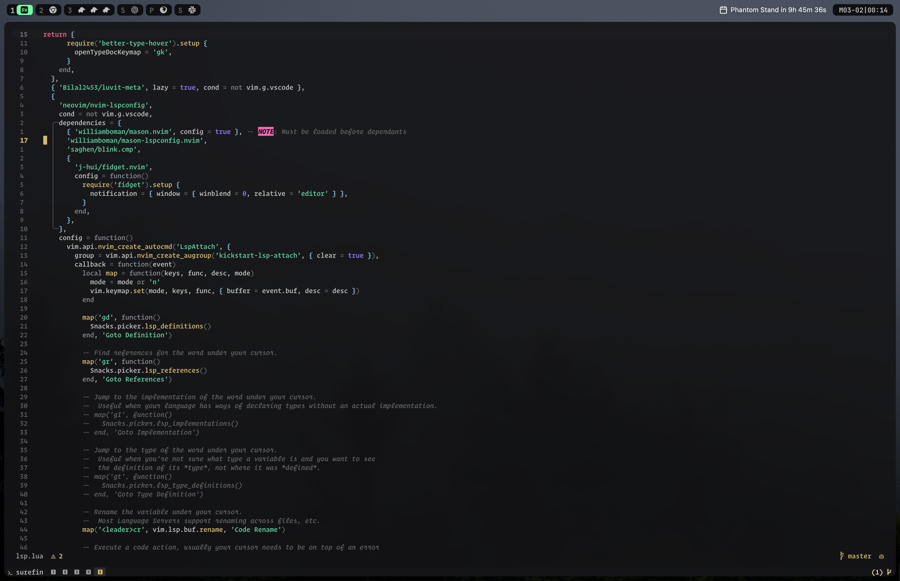

# dotfiles

My config for macOS (daily driver) and Arch Linux.



## macOS

- **Window manager:** [rift](https://github.com/acsandmann/rift), with tiling and 5 virtual workspaces on Alt+1…5
- **Bar:** [SketchyBar](https://github.com/FelixKratz/SketchyBar), configured in Lua
- **Terminal:** WezTerm (nightly), plus a floating scratchpad window for notes on ⌥N
- **Keyboard:** Karabiner. Caps Lock is Control when held and Escape when tapped; Right Option is Hyper
- **Launcher:** Raycast (settings in `platform/macos/config.rayconfig`)
- **Secrets:** Bitwarden app, plus the `rbw` CLI for loading environment variables

```bash
git clone git@github.com:schester44/dotfiles.git ~/.dotfiles
~/.dotfiles/install-mac.sh
```

The script installs Homebrew packages, symlinks configs, installs Node through nvm, installs fonts, applies macOS defaults (Dock, Finder, key repeat), and starts SketchyBar and rift. It prints the remaining manual steps when it finishes.

## Arch Linux

Hyprland, Waybar, Walker. Install with `./install.sh`.

## Shared

- **Neovim:** `home/.config/nvim`
- **Zsh:** `home/.zshrc`, `home/.config/zsh` (aliases, functions, `wt` for git worktrees)
- **Git:** `home/.gitconfig` (delta pager). Machine-specific settings go in `~/.gitconfig.local`
- **Other configs:** tmux, starship, lazygit, pi agent (`home/.pi/agent`)

Local, uncommitted files: `~/.env` (secrets), `~/.zshrc.local`, `~/.gitconfig.local`.

## Layout

```
home/            symlinked into ~
platform/macos/  rift, sketchybar, karabiner, raycast, scratchpad, brew.sh, defaults
install/         Linux install scripts
bin/             scripts on PATH (sc, tunnel, kport)
system/          colors, theme templates, package lists, fonts
scripts/         vault-sync
wezwork/         WezTerm agent switcher (Go)
```
